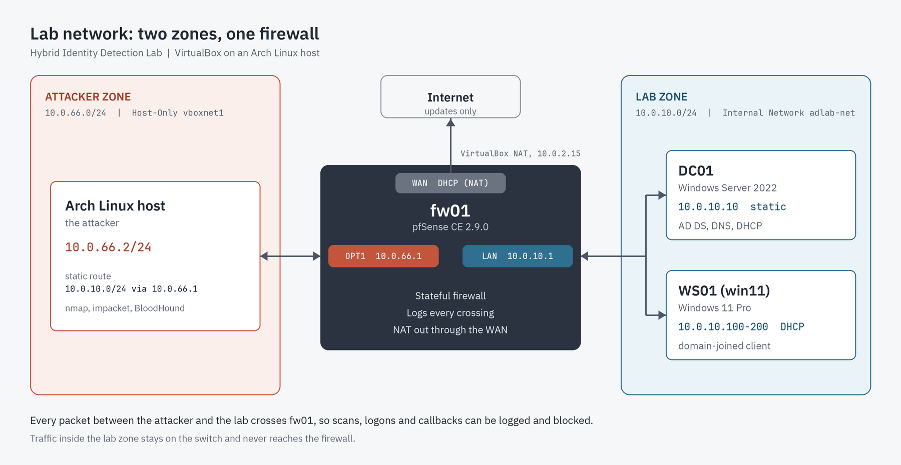

# Network Design

**Project:** Hybrid Identity Detection Lab
**Document:** Network architecture and design rationale
**Status:** Phase 0 (design approved, not yet built)

---

## 1. Purpose

This document describes the network used by the lab and explains why each design decision was made. The network has to meet four requirements:

1. **Authentic identity infrastructure.** An Active Directory domain with a domain controller, DNS, DHCP and a domain-joined client behaves the way it does in a real organisation.
2. **Controlled attack path.** Attacks launched from the host machine must cross a firewall so the network layer can log and block them.
3. **Strict isolation.** Attack traffic must never reach a real network, and lab machines may reach the internet only for updates.
4. **Reproducibility.** The lab can be reset to a known-good state with snapshots.

## 2. Architecture overview

```
┌──────────────────────────────────────────────────────────────┐
│ ARCH LINUX HOST (attacker)                                   │
│ vboxnet0: 10.0.66.2/24                                       │
│ static route: 10.0.10.0/24 via 10.0.66.1                     │
└──────────────────────────────┬───────────────────────────────┘
                               │ VirtualBox Host-Only (vboxnet0)
                               │ ATTACKER ZONE  10.0.66.0/24
                        ┌──────┴───────┐
                        │   pfSense    │  OPT1 (ATTACK): 10.0.66.1
          internet ◄────┤     fw01     │  LAN:           10.0.10.1
        (updates only)  │              │  WAN:           NAT (DHCP)
          VBox NAT      └──────┬───────┘
                               │ VirtualBox Internal Network "LabNet"
                               │ SERVER/CLIENT ZONE  10.0.10.0/24
                     ┌─────────┴──────────┐
               ┌─────┴─────┐        ┌─────┴─────┐
               │   dc01    │        │   ws01    │
               │ 10.0.10.10│        │ DHCP .100 │
               │ AD DS     │        │ Windows   │
               │ DNS, DHCP │        │ 10/11     │
               └───────────┘        └───────────┘
```



The firewall sits between the attacker zone and the lab zone. The attacker host cannot reach the domain controller or the workstation except by crossing pfSense.

## 3. Addressing plan

| Host | Hostname | Interface | Address | Assignment | Role |
|---|---|---|---|---|---|
| pfSense | fw01 | WAN | DHCP from VirtualBox NAT (10.0.2.x) | Dynamic | Internet egress |
| pfSense | fw01 | LAN | 10.0.10.1/24 | Static | Gateway for lab zone |
| pfSense | fw01 | OPT1 (ATTACK) | 10.0.66.1/24 | Static | Gateway and sensor for attacker zone |
| Windows Server | dc01 | Ethernet | 10.0.10.10/24 | Static | AD DS, DNS, DHCP |
| Windows 10/11 | ws01 | Ethernet | 10.0.10.100 to .200 | DHCP from dc01 | Domain-joined client |
| Arch host | n/a | vboxnet0 | 10.0.66.2/24 | Static | Attacker |

**Address ranges.** Both subnets come from RFC 1918 private space, so they cannot collide with public addresses. `10.0.10.0/24` and `10.0.66.0/24` were chosen to avoid VirtualBox's default Host-Only range (`192.168.56.0/24`) and the VirtualBox NAT range (`10.0.2.0/24`). Using distinct third octets also makes the zone obvious from the address alone (`10.0.66.x` is always the attacker).

**Static versus dynamic.** Infrastructure that other systems depend on (gateway, domain controller) uses fixed addresses. Clients use DHCP, as workstations do in a real organisation. Conventions: gateways at `.1`, servers at low addresses, client pool at `.100` to `.200`.

## 4. VirtualBox network modes

| Mode | VM to VM | VM to host | VM to internet | Used for |
|---|---|---|---|---|
| NAT | No | No | Yes (outbound only) | pfSense WAN |
| Internal Network | Yes (same name) | No | No | LabNet (dc01, ws01, pfSense LAN) |
| Host-Only | Yes | Yes | No | Attacker zone (pfSense OPT1 and the Arch host) |
| Bridged | Yes | Yes | Yes (on the real LAN) | Not used |

**Why Internal Network for the lab zone.** An Internal Network is completely sealed from the host and the internet. The only way out of `dc01` and `ws01` is through pfSense, so the firewall is the single choke point for everything the targets send or receive.

**Why Host-Only for the attacker zone.** Host-Only is the one mode that places the physical Arch host on a virtual network with a VM. The host runs the attack tools, so it has to be on this wire.

**Why not Bridged.** A bridged adapter puts lab machines on the real home or office network. Attack traffic and intentionally weakened systems would be exposed to real devices. It is excluded on safety grounds.

## 5. Design decisions and rationale

### 5.1 Why two zones instead of one flat network

Hosts on the same subnet exchange frames at Layer 2 through the (virtual) switch. A router or firewall only sees traffic that crosses a subnet boundary. If the attacker and the domain controller shared `10.0.10.0/24`, a port scan against `dc01` would never touch pfSense, so the firewall could neither log nor block it.

Placing the attacker in `10.0.66.0/24` forces every packet to the lab zone through pfSense. That gives the lab:

- Firewall logs of scans, connection attempts and reverse-shell callbacks, which become a Wazuh and Sentinel data source in later phases.
- The ability to write and test rules between zones, including allow-listing the specific protocols an internal attacker would use.
- A model of the threat that matters for identity attacks: a foothold inside the network that reaches server-side services such as Kerberos (88), LDAP (389), SMB (445) and RPC (135).

### 5.2 Why the firewall is a VM and not the domain controller

The source tutorial has the domain controller perform NAT and routing through Windows Remote Access. That works for a demo but conflates two roles that are separated in production. A dedicated firewall:

- keeps the domain controller's attack surface to directory services,
- produces independent network logs that an attacker with control of the DC cannot easily tamper with,
- supports stateful filtering, logging and later extensions such as Suricata.

### 5.3 Why pfSense has three interfaces

| Interface | Mode | Reason |
|---|---|---|
| WAN | NAT | Outbound internet for updates. VirtualBox NAT blocks unsolicited inbound connections. |
| LAN | Internal "LabNet" | Sealed network for targets. |
| OPT1 (ATTACK) | Host-Only `vboxnet0` | Entry point for attacker traffic, and the sensor point. |

Keeping WAN, LAN and attacker zones on separate interfaces means each has its own rule set and its own log stream.

### 5.4 Why a static route on the host

The Arch host is directly connected to `10.0.66.0/24` but has no knowledge of `10.0.10.0/24`. Without a route it would send that traffic to the real default gateway, where it would be dropped or leak. The route tells the host to hand lab-zone traffic to pfSense:

```bash
sudo ip route add 10.0.10.0/24 via 10.0.66.1
```

The return path needs no extra configuration: `dc01` and `ws01` use pfSense as their default gateway, and pfSense knows `10.0.66.0/24` is on OPT1.

Packet walk for `nmap 10.0.10.10` from the host:

1. Host consults its routing table, matches `10.0.10.0/24 via 10.0.66.1`, and ARPs for `10.0.66.1`.
2. pfSense receives the packet on OPT1 and evaluates OPT1 firewall rules.
3. If allowed, pfSense routes it out of LAN to `10.0.10.10` (plain routing, no NAT between internal zones).
4. `dc01` replies to the host's address; its default gateway is `10.0.10.1`, so the reply returns through pfSense, which tracks the connection statefully.

### 5.5 Why DHCP and DNS live on the domain controller

- **DNS.** Active Directory depends on DNS SRV records (for example `_ldap._tcp.dc._msdcs.<domain>`) to locate domain controllers and Kerberos services. `ws01` must use `dc01` (10.0.10.10) as its DNS server. If it pointed at pfSense or a public resolver, domain join and authentication would fail. `dc01` forwards queries it cannot answer to pfSense (10.0.10.1).
- **DHCP.** Running DHCP on `dc01` follows the common Windows enterprise pattern and hands out the gateway (10.0.10.1) and DNS server (10.0.10.10) in one lease. DHCP on pfSense's LAN interface is disabled to avoid two servers answering.
- **Domain name.** The lab uses the internal AD domain `lab.internal`, also set as pfSense's domain. `.local` was rejected: it is widely used for mDNS, pfSense warns against it, and Microsoft advises against it for Active Directory. `.internal` is reserved for private use. A non-routable domain will not sync to Entra ID as it is, so Phase 5 adds an alternate UPN suffix as described in the project brief.

### 5.6 Why a single lab zone for servers and clients

Splitting servers and workstations into separate subnets is the more mature design, but it adds interfaces, routing and DHCP relay without teaching more about the identity attacks this lab targets. The decision is deliberate. The design extends cleanly: add a second pfSense interface, move `ws01` to it, and add DHCP relay and inter-zone rules.

## 6. Firewall policy (pfSense)

Default behaviour: pfSense blocks inbound traffic on WAN and OPT1, and allows outbound from LAN. Starting policy:

| Interface | Rule | Purpose |
|---|---|---|
| WAN | Disable "Block private networks" | The WAN sits behind VirtualBox NAT, so its gateway (10.0.2.2) and DNS (10.0.2.3) are private addresses. The block rule drops packets arriving on WAN from private sources, which can interfere with traffic from VirtualBox itself. Outbound internet access does not depend on it. |
| LAN | Allow LAN to any (initial) | Lets hosts update. Tighten later (see below). |
| OPT1 | Allow `10.0.66.2` to `10.0.10.0/24` (logged) | Permits attacker traffic into the lab and generates logs. |
| OPT1 | Block and log everything else | Prevents the attacker zone reaching the internet through the lab firewall. |

**Planned tightening in Phase 1 and 2.** Restrict LAN egress to Windows Update and DNS, and add logged block rules so that the firewall's behaviour (scan blocked versus scan allowed) can be compared in detections.

**Management access.** The pfSense web interface listens on LAN by default. Reach it from `ws01` initially. If browsing from the Arch host is wanted, add a narrow, temporary OPT1 rule allowing `10.0.66.2` to `10.0.10.1:443` and remove it afterwards.

## 7. Isolation and safety controls

- **No bridged adapters** on any lab VM.
- **IP forwarding stays off on the Arch host** (`net.ipv4.ip_forward=0`), so the host never routes lab traffic to its real network.
- **The only internet path** is the pfSense WAN NAT adapter, used for updates.
- **Attacks target only the lab ranges** `10.0.10.0/24`. Keep tooling scoped to that range.
- **Evaluation licences and an isolated Entra test tenant** only.
- **Snapshots** before every major change and every attack (naming in section 9).
- **Host-Only range on Arch.** VirtualBox on Linux only allows Host-Only ranges listed in `/etc/vbox/networks.conf`. Add:
  ```
  * 10.0.66.0/24
  ```
- **Host-Only DHCP server disabled**, so it does not compete with static addressing.

## 8. Logging and monitoring touchpoints

| Source | Location | Used in |
|---|---|---|
| pfSense filter logs (scans, blocks, callbacks) | fw01 | Phase 2 (Wazuh), Phase 4 (Sentinel replay) |
| Windows Security and Sysmon events | dc01, ws01 | Phase 2 |
| DNS and DHCP logs | dc01 | Phase 2 |
| Entra sign-in logs | Entra tenant | Phase 5 |

Wazuh placement (local VM, or installed directly on the VPS) is an open decision for Phase 2. If it runs on the VPS, log forwarding from the lab goes out through the pfSense WAN path and will need an explicit firewall allowance.

## 9. Resource plan and snapshot convention

| VM | RAM | vCPU |
|---|---|---|
| fw01 (pfSense) | 1 GB | 1 |
| dc01 (Windows Server) | 3 GB | 2 |
| ws01 (Windows 10/11) | 2 GB | 2 |
| **Total** | **6 GB** | |

This leaves roughly 9 to 10 GB for the Arch host on a 16 GB machine.

Snapshot names follow `phase<N>-<state>-<detail>`, for example `phase1-pre-ad-install`, `phase1-hardened-baseline`, `phase2-pre-kerberoast`. The `phase1-hardened-baseline` snapshot is the clean restore point for all attack scenarios.

## 10. Verification checklist (end of Phase 1)

- [ ] `ws01` receives a DHCP lease with gateway `10.0.10.1` and DNS `10.0.10.10`.
- [ ] `ws01` joins the domain and a domain user can log in.
- [ ] `dc01` and `ws01` reach the internet through pfSense (Windows Update works).
- [ ] From the Arch host, `ping 10.0.10.10` succeeds only once an OPT1 allow rule and the host route exist.
- [ ] A test connection from the Arch host to `dc01` appears in the pfSense firewall log.
- [ ] `dc01` and `ws01` cannot be reached from the real LAN.
- [ ] Packet capture on pfSense OPT1 shows attacker traffic to the lab zone.

## 11. Known limitations and extension path

- **Single lab zone.** Servers and clients share a subnet; lateral movement between them does not cross the firewall. Splitting them is the first extension.
- **Attacker is the host.** The Arch host shares the machine with the hypervisor. Attack tooling should stay in a dedicated user account or directory and never be run against any address outside `10.0.10.0/24`.
- **Optional additions.** Suricata on pfSense for IDS alerts, a Linux Syslog server in the lab zone, and OpenVAS scanning from the attacker zone.

## 12. Interview talking points

- Why traffic must cross a subnet boundary for a firewall to see it.
- The difference between NAT, Internal, Host-Only and Bridged networking and why each was chosen.
- How the static route and default gateways create a symmetric path through the firewall.
- Why AD clients must use the domain controller for DNS.
- The deliberate trade-off of one lab zone, and how it would be segmented in production.
